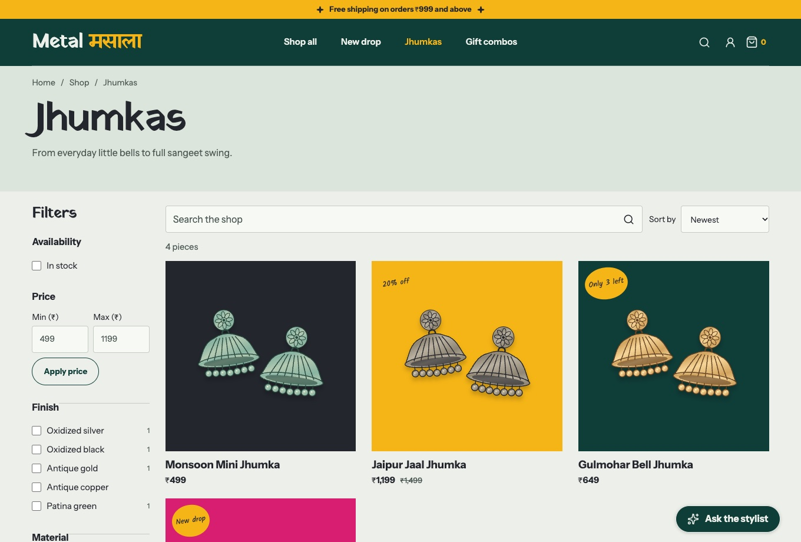
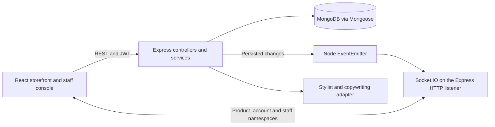

# Metal मसाला

Metal मसाला is a storefront for handcrafted Indian jewellery. Customers can browse and filter the catalogue, ask the stylist for recommendations, save favourites, and track orders. Staff can maintain inventory and fulfil orders. Admins can also view analytics and manage customer accounts.



## Run locally

Use Node.js 22.12 or later and MongoDB. Docker is an option for the supplied local database configuration.

```sh
cd server
npm ci
cp .env.example .env
docker compose up -d mongo
npm run seed -- --import
npm run dev
```

For an existing local MongoDB, skip Docker and point `MONGODB_URI_LOCAL` at it. For a development Atlas database, set `DB_TARGET=atlas`, supply `MONGODB_URI` in the ignored `server/.env`, and choose `DB_NAME`. Keep demo seeds in an isolated development database. Rerunning the seed import preserves existing records and upgrades the fixed Phase 3 demo accounts’ placeholder passwords.

Open a second terminal at the repository root.

```sh
cd client
npm ci
cp .env.example .env
npm run dev
```

Open `http://localhost:5173`. Vite proxies `/api` and `/socket.io` to the Express server on port 4000. The [MongoDB setup](docs/mongodb-setup.md) covers database diagnostics. The React app uses the API for every feature. The guest bag lives in the browser and merges into the account cart after sign-in.

### Demo accounts

Use the value set in `DEV_SEED_PASSWORD`. The local example is `ChangeMe#123`.

| Role | Email | Access |
| --- | --- | --- |
| Customer | `aarav@example.com` | Checkout, account, reviews, wishlists, and order tracking |
| Manager | `manager@metalmasala.in` | Catalogue edits, order processing, and drop announcements |
| Admin | `admin@metalmasala.in` | Manager capabilities plus catalogue deletion, analytics, and user management |

## Architecture



| Layer | Stack and entry points |
| --- | --- |
| `client/src/` | React, Vite, React Router, TanStack Query, Zustand, and Axios |
| `server/src/` | Node.js, Express, Zod, Mongoose, bcrypt, JWT, and Socket.IO |
| `server/scripts/` | MongoDB seeding and connectivity checks, catalogue export, and raw WebSocket demo |
| `server/api-tests/` and `server/test/` | HTTP recipes, a Postman collection, and automated Node and Supertest checks |
| `docs/` | API contract, architecture, project review, and lecture evidence |

The [API contract](docs/01_API_CONTRACT.md) covers catalogue, pricing, accounts, carts, orders, staff tools, analytics, and realtime events. The [authorization audit](docs/authz.md) maps those routes to their guards. The [realtime guide](docs/websockets.md) explains Socket.IO and the independent WebSocket demo.

## Configuration

| Variables | What they control |
| --- | --- |
| `PORT`, `CLIENT_ORIGIN` | Express port and exact trusted browser origin |
| `DB_TARGET`, `DB_NAME`, `MONGODB_URI_LOCAL`, `MONGODB_URI` | Local or Atlas database selection and connection |
| `JWT_ACCESS_SECRET`, `JWT_REFRESH_SECRET` | Separate signing keys of at least 32 characters. Generate two values using `openssl rand -hex 32`. Production requires both. Local development generates temporary keys when unset. |
| `JWT_ACCESS_EXPIRES`, `JWT_REFRESH_EXPIRES` | Token lifetimes. Defaults are `15m` and `7d`. |
| `BCRYPT_ROUNDS`, `DEV_SEED_PASSWORD` | Password hashing cost and development-only fixture password |
| `COOKIE_SECURE`, `COOKIE_SAME_SITE` | Use `true` for production cookies. For separate sites serving the SPA and API, set `COOKIE_SAME_SITE=none` with HTTPS and `COOKIE_SECURE=true`. |
| `VITE_API_URL`, `VITE_SOCKET_URL` | Browser-facing endpoints. A relative API URL and empty socket URL use the same origin. |
| `AI_PROVIDER`, `AI_API_KEY`, `AI_MODEL` | Provider and optional credentials. The default `mock` provider returns deterministic catalogue-based suggestions and copy. `gemini` uses the configured external service. |

The stylist retrieves matching products before it calls the provider. The server accepts recommendations only from that candidate list. Checkout exercises COD, demo UPI, and demo card flows. The notification service logs sample email text through `DEBUG=mm:data`.

## Verification and scripts

| Run from | Commands |
| --- | --- |
| `server/` | `npm test`, `npm run lint`, `npm run db:ping`, `npm run ws:demo`, `npm run ws:client` |
| `client/` | `npm run lint`, `npm run build`, `npm run preview` |

See the [project review](docs/PROJECT_REVIEW.md) for the demo walkthrough, verification notes, and limitations. The [implementation map](docs/07_IMPLEMENTATION_MAP.md) links course lectures to their evidence.

## Team

| Phase | Owner | Work |
| --- | --- | --- |
| B1 | Mehak | Node and Express foundations, catalogue routes |
| B2 | Nitesh | MVC, middleware, configuration, and MongoDB setup |
| B3 | Tanishq | MongoDB data layer, commerce, analytics, and AI |
| B4 | Aakash | Authentication, authorization, events, realtime, and full-stack integration |
