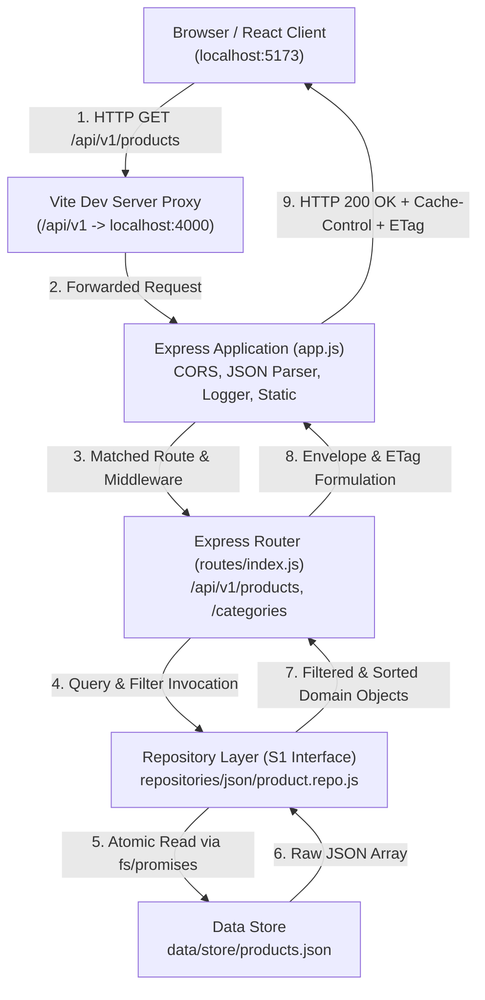

# Architecture & Request Lifecycle [L1]

This document traces the end-to-end request lifecycle of **Metal मसाला**, demonstrating clean client/server separation, layered server architecture, and how components evolve across the development phases.

---

## 1. Request Lifecycle Diagram

When a user navigates to the shop page or a client application requests jewellery catalogue data, the request flows through distinct architectural layers:



---

## 2. Step-by-Step Request Trace (`GET /api/v1/products`)

### Step 1: Client Dispatch
The React frontend (TanStack Query / Axios) requests catalogue items:
```http
GET /api/v1/products?category=jhumkas&sort=popular HTTP/1.1
Host: localhost:5173
```

### Step 2: Vite Proxy Forwarding
Because client and server operate on different ports during development (Vite on `5173`, Express on `4000`), Vite's dev server proxies calls matching `/api` and `/socket.io` to `http://localhost:4000`. This eliminates cross-origin browser restrictions in development while preserving the production path structure.

### Step 3: Express Middleware Pipeline (`server/src/app.js`)
The request arrives at Express on port 4000:
1. **CORS:** Validates origin against `CLIENT_ORIGIN` (`http://localhost:5173`) and sets credentials headers.
2. **Body Parsers:** `express.json({ limit: '1mb' })` parses JSON payloads on write requests.
3. **Static Server:** Serves assets from `server/public/` if matched.
4. **Request Logger & Tracing:** Assigns or forwards a unique `X-Request-Id` (UUID) and records the incoming request in memory and `logs/access.log`.

### Step 4: Router Dispatch (`server/src/routes/product.routes.js`)
The request is matched to the product router mounted at `/api/v1/products`.
- Extracts `req.query`: `category='jhumkas'`, `sort='popular'`.
- Sanitizes and sets defaults for pagination (`page=1`, `limit=12`).

### Step 5: Repository Interface (`server/src/repositories/json/product.repo.js`)
The route handler calls the repository layer:
```javascript
const { items, total } = await productRepo.findMany({
  filter: { category: 'jhumkas' },
  sort: 'popular',
  page: 1,
  limit: 12
});
```

### Step 6 & 7: Storage & Virtuals
1. The repository reads `data/store/products.json` using atomic `fs/promises` via `jsonStore.js`.
2. Applies filter predicates (category matching, price bounds, in-stock status).
3. Sorts by `soldCount` descending.
4. Applies virtual fields: `inStock = stock > 0`, `discountPercent = ((compareAtPrice - price) / compareAtPrice) * 100`.
5. Slices the array for the requested page and limit.

### Step 8 & 9: Response Formulation & ETag
1. Route handler calculates a weak SHA-1 ETag of the results (`W/"<hash>"`).
2. Sets `Cache-Control: public, max-age=60`.
3. Checks `If-None-Match` header. If matched, returns `304 Not Modified`.
4. Wraps results in the API contract success envelope:
```json
{
  "success": true,
  "data": [ ... ],
  "meta": {
    "page": 1,
    "limit": 12,
    "total": 6,
    "totalPages": 1,
    "hasNext": false,
    "hasPrev": false
  }
}
```

---

## 3. Layer Evolution Across Project Phases

The architecture was deliberately organized into decoupled seams (S1–S7) so each curriculum phase replaces or enhances specific layers without rewriting adjacent ones:

| Layer | B1 (Foundations — Mehak) | B2 (MVC & Middleware — Nitesh) | B3 (Data & AI — Tanishq) | B4 (Auth & Realtime — Aakash) |
|---|---|---|---|---|
| **Entrypoint** | `src/server.js` (http.listen, shutdown) | Adds DB connect before listen | DB connect with retry/backoff | Sockets + HTTP server sharing |
| **App Skeleton** | `src/app.js` (Express core, basic error) | Central `AppError`, zod validator, helmet, rate-limit | Unchanged | Socket.IO attachments, cookie parser |
| **Routing** | Handlers inline inside `routes/*.routes.js` | Refactored into `controllers/` + `services/` | Unchanged route signatures | `protect` and `restrictTo` guards activated |
| **Data Access (S1)** | `repositories/json/*.repo.js` | Formal repository interface | Swapped to `repositories/mongo/*.repo.js` | Unchanged repository signatures |
| **Persistence** | Atomic JSON files (`data/store/`) | MongoDB setup & connection scripts | MongoDB Atlas / local collections with Mongoose | Real auth & token collections |
