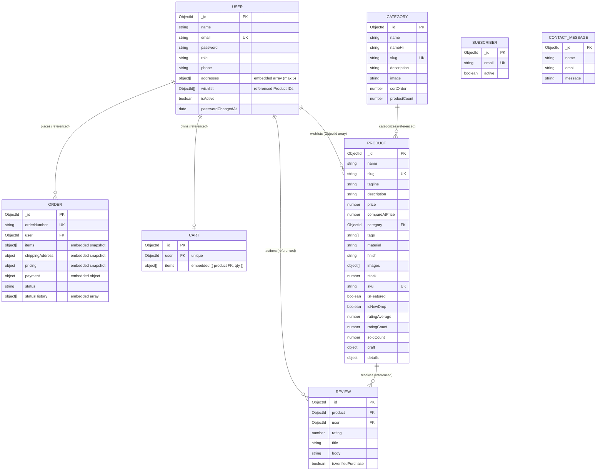

# Data Modelling & Database Relationships · [L24]

This document outlines the data model, entity relationships, schema decisions, and validation architecture for **Metal मसाला**.

---

## 1. Entity-Relationship Diagram



---

## 2. Embedding vs Referencing Decisions · [L24]

MongoDB document modelling balances normalization and denormalization. The table below details our architectural decisions for each relationship:

| Relationship | Design Decision | Technical Rationale |
|---|---|---|
| **Product → Category** | **Reference** (`category` ObjectId) | Categories are few (8 seed categories) and updated infrequently. Products are queried and filtered by category ID/slug. Referencing avoids massive cascading updates when category metadata changes. |
| **Order → Items** | **Embedded Snapshot** | Historical price, product name, slug, and image thumbnail must be frozen at the time of purchase. If a product's price increases or a product is discontinued, existing order records must remain immutable and legally accurate. |
| **Order → Shipping Address** | **Embedded Snapshot** | The address where an order was shipped must be preserved as it was when the order was placed, independent of subsequent updates to the user's saved address book. |
| **User → Addresses** | **Embedded Array** (max 5) | Addresses are always accessed within the context of a user profile or checkout selection. They are strictly bounded (1-5 addresses per user), making embedding optimal for single-roundtrip retrieval. |
| **User → Wishlist** | **Array of References** (`ObjectId[]`) | Bounded list of product identifiers. Storing product ObjectIds allows the client to fetch updated stock and price while keeping user document size minimal. |
| **Cart → Items** | **Embedded** (`[{ product, qty }]`) | Each user has at most one cart with typically 1 to 20 items. Embedding keeps cart read/write atomic and fast without multi-document joins. |
| **Review → Product / User** | **Referenced Collection** | Reviews have unbounded growth potential (a popular product may accumulate thousands of reviews). Storing them in a separate collection prevents document growth beyond the 16MB BSON limit and enables paginated queries. |
| **Subscriber / Contact** | **Standalone Collections** | Independent operational documents with lifecycle distinct from user accounts. |

---

## 3. Two-Layer Validation Architecture · [L26]

Metal मसाला implements a robust two-layer validation strategy:

```
[ HTTP Request ]
       │
       ▼
┌──────────────────────────────────────┐
│ Layer 1: Edge Validation (Zod)       │  → Rejects malformed payload with 422 before controller
│ (src/validators/*.js)                │  → Validates request shape, strings, regex, boundaries
└──────────────────────────────────────┘
       │ Validated Request Body
       ▼
┌──────────────────────────────────────┐
│ Application / Business Services      │  → Orchestrates pricing, transactions, stock checks
└──────────────────────────────────────┘
       │ Domain Operations
       ▼
┌──────────────────────────────────────┐
│ Layer 2: Model Validation (Mongoose) │  → Schema constraints, custom validators, runValidators: true
│ (src/models/*.js)                    │  → Custom rules: compareAtPrice ≥ price, pincode, phone
└──────────────────────────────────────┘
       │ Safe Document Persistence
       ▼
[ MongoDB Database ]
```

### Layer 1: Edge Validation (Zod Middleware)
- Runs immediately at the route boundary (`validate({ body, query, params })`).
- Ensures untrusted user input is sanitised and conformant before touching business logic.
- Converts invalid requests to standardized `422 VALIDATION_ERROR` responses with detailed issue breakdown.

### Layer 2: Schema Validation (Mongoose ODM)
- Guaranteed persistence-layer enforcement that catches domain invariant violations even when bypassing HTTP endpoints (e.g. background tasks, scripts, tests).
- Custom validators:
  - `compareAtPrice >= price`: guarantees discount logic validity.
  - `phone`: strictly 10 digits regex `^\d{10}$`.
  - `pincode`: strictly 6 digits regex `^\d{6}$`.
  - `rating`: integer between 1 and 5.
- Update operations explicitly pass `{ runValidators: true }` to enforce schema constraints on partial updates.
