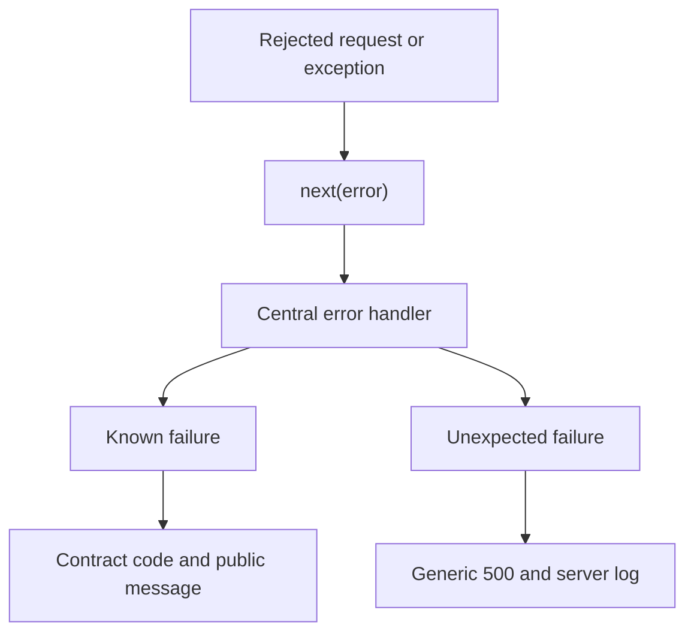

# Central error handling · L18

The Express application uses one error handler for input failures, missing resources, conflicts, and unexpected exceptions. Services throw `AppError` when they can describe an operational failure. `catchAsync` forwards rejected handlers to Express 4. Request IDs match the `X-Request-Id` response header.

| Source | HTTP | Public code |
| --- | --- | --- |
| Malformed JSON or URL | 400 | `BAD_REQUEST` |
| Invalid authentication | 401 | `UNAUTHENTICATED` |
| Expired access token | 401 | `TOKEN_EXPIRED` |
| Insufficient role | 403 | `FORBIDDEN` |
| Missing record or route | 404 | `NOT_FOUND` |
| Duplicate key or category in use | 409 | `CONFLICT` |
| Body over 10 KB | 413 | `BAD_REQUEST` |
| Invalid fields | 422 | `VALIDATION_ERROR` |
| Request quota reached | 429 | `RATE_LIMITED` |
| Unexpected exception | 500 | `INTERNAL_ERROR` |

Mongoose cast and validation errors, duplicate-key error 11000, and JWT failures are already mapped for the later phases. Full stacks for unexpected errors go to the server log. When `NODE_ENV=development`, an unexpected error may also include a stack in the JSON response. Production responses expose only the public message and request ID.
