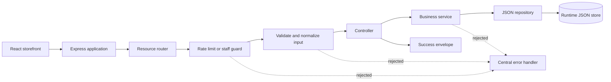

# MVC in Metal मसाला · L12–L14

The model is the repository layer. The React client is the view and consumes JSON. Express controllers translate HTTP requests into service calls and turn their results into responses. Services own business decisions, including slug collisions, category references, newsletter idempotency, and checkout fees.

## Example requests

A price quote accepts product IDs, quantities, and a payment method. The validator checks the body, the pricing service loads current catalogue prices, and the controller returns the quote. The service applies the shipping threshold and COD fee to the verified subtotal. Phase 3 can reuse its pure `calculateQuote` function after reading the real cart.

A staff product write first checks the development role. The service resolves category snapshots, normalizes slugs, and checks conflicts. The JSON adapter writes the record and projects stock and discount fields. The controller adds a `Location` header to the creation response.

Newsletter and contact submissions use the same controller, service, and repository pattern. Newsletter emails are trimmed and normalized to lowercase. An atomic create-if-absent write makes repeated subscriptions idempotent.

The [repository interface](../server/src/repositories/README.md) describes the methods the later MongoDB adapter must preserve.
